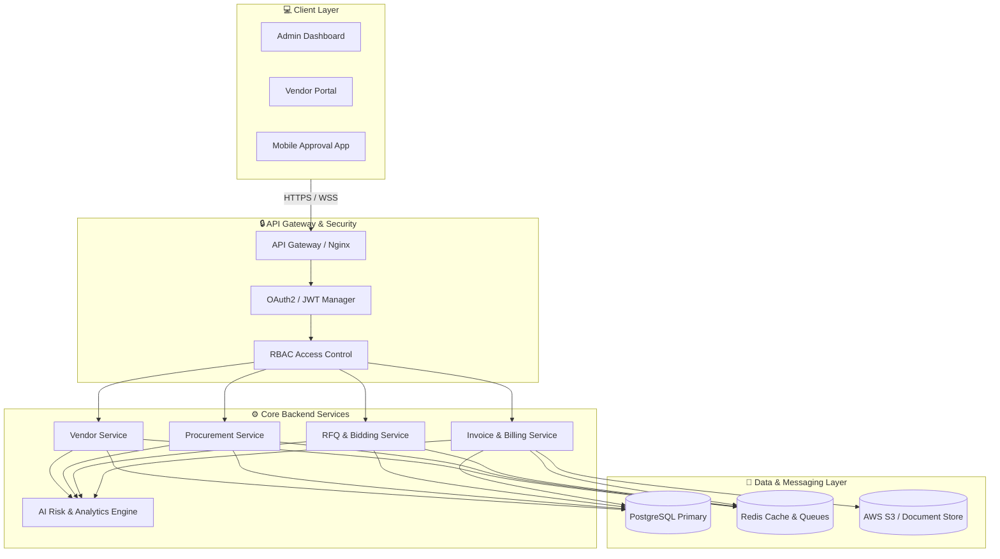

<div align="center">


**An end-to-end, AI-enabled enterprise procurement platform designed to streamline purchase requisitions, automate vendor evaluation, ensure contract compliance, and optimize organizational spend.**

</div>

---


During my 3-month **Infosys Springboard Virtual Internship 7.0**, I designed and developed three progressive backend and enterprise software engineering projects—culminating in the **Smart Procurement & Vendor Management System (SPVMS)**.

SPVMS modernizes traditional supply chain and procurement workflows by replacing fragmented manual spreadsheets with automated purchase order lifecycles, real-time vendor risk scoring, and automated RFQ comparisons—reducing procurement turnaround times by up to **65%** while maintaining strict audit trails and compliance.

---


This capstone consolidates my work across the three software engineering milestones completed during the internship. You can explore, review, or inspect the standalone repositories for each individual project below:

| Project Module | Description | Repository Link |
| :--- | :--- | :--- |
| 🏦 **Bank Management System** | Core banking operations, account handling & transaction management | [Infosys_project_1_bank_management_system](https://github.com/just-deva/Infosys_project_1_bank_management_system) |
| 🎓 **Student Management API** | RESTful API for student records, enrollments & academic data management | [infosys_project2_student_management_api](https://github.com/just-deva/infosys_project2_student_management_api) |
| 📦 **Smart Procurement & Vendor Management** | Automated procurement workflows, purchase orders & vendor tracking system | [Infosys-project3-Smart-Procurement-and-Vendor-Management-System](https://github.com/just-deva/Infosys-project3-Smart-Procurement-and-Vendor-Management-System) |

---


* **🤝 Vendor Registry & Risk Scoring:** Centralized vendor onboarding with profile management, compliance verification, and AI-assisted performance/risk evaluation.
* **📝 Purchase Requisition & Approval Flow:** Structured request submission and multi-tier review pipeline to validate budget and procurement needs before order generation.
* **⚖️ Automated RFQ & Bidding Management:** Streamlined Request for Quotation creation and side-by-side vendor quote evaluation.
* **🧾 Automated Purchase Order (PO) & Invoicing:** End-to-end PO lifecycle tracking (`Draft` → `Approved` → `Dispatched` → `Fulfilled`) paired with automated billing and document storage.
* **🔐 OAuth2 / JWT & Role-Based Access Control (RBAC):** Strict access separation between requesters, approvers, finance teams, and vendor administrators.

---


```text
┌──────────────────────┐     ┌──────────────────────┐     ┌──────────────────────┐
│  Vendor Onboarding   │────▶│ Purchase Requisition │────▶│  Approval & RFQ      │
│  & Catalog Setup     │     │     Submission       │     │  Evaluation Flow     │
└──────────────────────┘     └──────────────────────┘     └──────────┬───────────┘
                                                                     │
┌──────────────────────┐     ┌──────────────────────┐                ▼
│  Invoice Matching    │◀────│   Vendor Dispatch    │◀────┌──────────────────────┐
│  & Audit Closure     │     │   & Fulfillment      │     │   Purchase Order     │
└──────────────────────┘     └──────────────────────┘     │    (PO) Generated    │
                                                          └──────────────────────┘
```

---


The platform follows a modular, event-driven microservices architecture ensuring high availability, security, and seamless integration with external ERP systems.



---


<details>
<summary><strong>📦 Click to expand setup & installation instructions</strong></summary>

<br>

1. **Clone the repository**
   ```bash
   git clone [https://github.com/just-deva/Infosys-project3-Smart-Procurement-and-Vendor-Management-System.git](https://github.com/just-deva/Infosys-project3-Smart-Procurement-and-Vendor-Management-System.git)
   cd Infosys-project3-Smart-Procurement-and-Vendor-Management-System
   ```

2. **Run with Docker (Recommended)**
   ```bash
   docker-compose up --build
   ```

3. **Or run locally (Backend & Frontend)**
   ```bash
   # Backend (FastAPI)
   pip install -r requirements.txt
   uvicorn app.main:app --reload

   # Frontend (React)
   cd frontend
   npm install && npm run dev
   ```

4. **Explore API Documentation**
   Once the server is running, open `http://localhost:8000/docs` for interactive Swagger UI documentation.

</details>

---


**Devadarshini S**  
B.Tech Computer Science & Engineering (Cybersecurity) — Amrita Vishwa Vidyapeetham  
GitHub: [@just-deva](https://github.com/just-deva) • Licensed under the **Apache-2.0 License**
